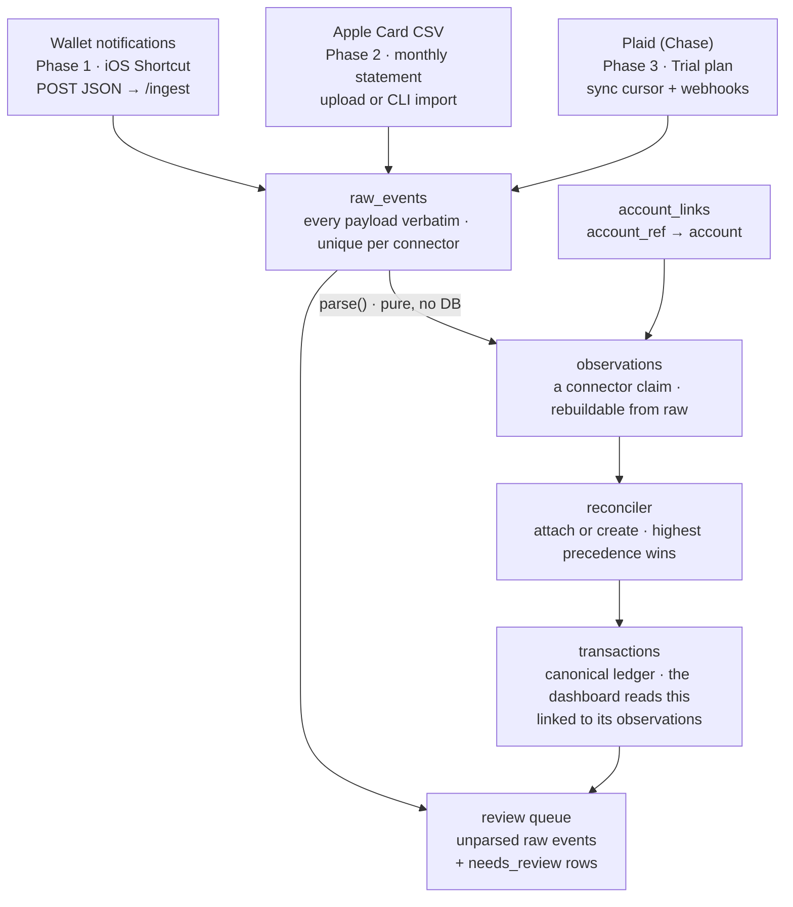

# aggregate — Finance Ledger Spec v1.1

Oct 28, 2026 · Trevor Drozd · v1.1, Nov 3, 2026: agreed changes folded in; each one is logged with its reason in `docs/decisions.md`.

## Read me first

Build **Phase 1 only**, then stop and report against the acceptance criteria. The repository is **public**: no secrets, real transactions or private hostnames go into code, fixtures, docs or commit messages.

1. Collect the inputs listed under Open questions & inputs before writing code.
2. Make the first commit a walking skeleton: layout, `CLAUDE.md`, `Makefile`, pre-commit, CI, a `/healthz` route with one test, and a Dockerfile. Get CI green before any feature work.
3. Then build each step on a branch, with its tests in the same pull request: models and first migration, connector framework, Wallet connector, ingest pipeline, reconciliation create path, API, CLI.
4. Treat the data model and conventions as decisions. Ask Trevor before changing a table, a column's meaning or a convention.
5. Add no dependencies beyond the stack table without asking.
6. Log decisions in `docs/decisions.md`. Finish with what was built, test and coverage results, and any deviations from this spec.

## Context & goals

The service merges card transactions from several sources into one ledger Trevor can trust. Each source is a **connector**, and a reconciler turns what connectors report into canonical transactions.

- **Accounts:** Apple Card and Chase Freedom. Apple Card has no aggregator access, so it comes from iPhone Wallet notifications plus the monthly statement export. Chase comes through Plaid in Phase 3.
- **First connector:** an iOS 27 Shortcuts automation fires on every Wallet notification and POSTs its fields as a JSON object. The service cares only about that payload, not how it arrives; parsing and dedupe happen here.
- **Phase 1 delivers:** schema and migrations, the connector framework, the Wallet notification connector, idempotent ingest, pending transactions, a review queue, a CLI, tests, CI and a Docker image.
- **Public repo:** open source on GitHub, with `docs/shortcut.md` showing how to build the Shortcut. Real financial data and private infrastructure details never enter the repo.
- **Design driver:** notification text is not an API and can change. Every raw payload is kept, so a parser fix is a replay, never data loss.

## Scope

Phase 1 is the only build target. Later phases are designed here so the schema already fits them.

| Phase | Delivers |
| --- | --- |
| 1. Groundwork | Schema and migrations, connector framework, Wallet notification connector, ingest API, pending transactions, review queue, CLI, tests, CI, Docker image, Shortcut guide |
| 2. Apple Card statements | CSV import connector, pending-to-posted matching, void sweep |
| 3. Plaid | Chase via Plaid's Trial plan, cursor-based sync, webhooks |
| 4. Dashboard | UI, categorization rules, local-LLM categorization |

Out of Phase 1: UI, Plaid, CSV import, categorization, budgets, multi-currency and multiple users. Phase 1 still creates the columns later phases need (`supersedes_external_id`, `posted_on`, `retracted_at`), so no migration has to be rewritten.

## Stack & conventions

Python 3.12+, FastAPI, Pydantic v2, SQLAlchemy 2 with Alembic, and SQLite in WAL mode, packaged with Docker.

| Piece | Choice | Why |
| --- | --- | --- |
| API | FastAPI | Pydantic models are the request contract; bad payloads get a 422; free OpenAPI spec |
| Validation and config | Pydantic v2, pydantic-settings | Connector payloads, settings from env |
| ORM and migrations | SQLAlchemy 2 typed ORM, Alembic | The schema changes with each connector |
| Database | SQLite, WAL mode | Plenty for one household; Postgres stays a config change |
| CLI | Typer | Admin and cron commands |
| Server | uvicorn | Runs the FastAPI app in the container |
| Tests | pytest, pytest-cov, Hypothesis, httpx2 | Fixture tests plus property tests for the parsers; httpx2 backs FastAPI's TestClient |
| Lint and format | ruff | One fast tool for both |
| Git hooks | pre-commit, gitleaks | Fast checks and secret scanning before anything is committed |
| Types | mypy, strict on `src/` | Catches money and None bugs before runtime |
| Packaging | uv with a committed `uv.lock`, Docker | Reproducible installs everywhere |
| CI | GitHub Actions | The same steps as `make check`, plus build and security jobs |

**Conventions every module follows:**

- **Money:** integer cents (`amount_cents: int`), parsed from strings with `Decimal`. No float ever holds money.
- **Sign:** negative means money out (purchases, fees, interest); positive means money in (refunds, card payments, cashback). Each connector converts to this rule.
- **Time:** timestamps stored in UTC, plus the source's own `local_date` for matching. The display timezone comes from config (`AGGREGATE_TZ`).
- **Idempotency:** every write path is safe to repeat. Re-sending a payload returns the stored result and writes nothing.
- **Kinds:** `purchase`, `refund`, `payment`, `fee`, `interest`, `cashback`, `transfer`, `adjustment`, `other`. Payments and transfers never count as spending.
- **SQLite pragmas:** `foreign_keys=ON` and `journal_mode=WAL` on every connection; SQLite leaves foreign keys off by default.
- **Security:** bearer tokens on every route except `/healthz`, compared with `secrets.compare_digest`, deny by default. Secrets come from env; commit `.env.example`, never `.env`.
- **Logging:** ids and statuses only. Payload contents are financial data and log only at DEBUG.
- **Responses:** typed Pydantic models. Every error body has one shape: `{"error": {"code": "...", "message": "..."}}`.

## Build, CI & repo hygiene

CI exists from the first commit, and `make check` runs the same steps locally, so a green local run predicts a green build.

**Make targets** (each wraps `uv run`):

- `make setup`: `uv sync`, then install the pre-commit hooks.
- `make check`: lint, format check, type check, tests with coverage, migration check. Run it before every commit.
- `make test`, `make lint`, `make fmt`, `make typecheck`, `make migrate`, `make run` for single steps.

**CI** (`.github/workflows/ci.yml`, on pushes to `main` and on every pull request). Python jobs install with `uv sync --locked`, which fails on a stale lockfile.

| Job | Runs | Fails when |
| --- | --- | --- |
| lint | `ruff check`, `ruff format --check` | any lint error or unformatted file |
| typecheck | `mypy --strict` on `src/` | any type error |
| test | `pytest` with coverage | a test fails, or coverage drops below 85% |
| migrations | `alembic upgrade head` on an empty database, then `alembic check` | a migration fails, or the models drift from the migrations |
| secrets | gitleaks over the full history | anything that looks like a credential |
| docker | build the image, start it, call `/healthz`, POST `purchase.json` | the build or the smoke test fails |

**Supply chain**, all free on public repos:

- Dependabot for the `uv` and `github-actions` ecosystems, weekly ([uv guide](https://docs.astral.sh/uv/guides/integration/dependabot/)), plus Dependabot security alerts.
- CodeQL default setup for Python.
- Actions pinned to full commit SHAs, and workflows default to `permissions: contents: read`.

**Repo rules:**

- `main` is protected: changes land through pull requests with CI green. Claude Code works on branches and opens PRs with `gh`.
- Secret scanning with push protection is on, and gitleaks also runs in pre-commit.
- `.gitignore` covers `.env`, `data/`, `*.db`, `CLAUDE.local.md` and `tests/fixtures/private/`.
- Real captures live only in `tests/fixtures/private/`. A `private` pytest marker runs them locally and skips them in CI.
- MIT license unless Trevor picks another. The README states the project is not affiliated with Apple, Chase or Plaid.

## Claude Code setup

Seed `CLAUDE.md` from this spec in the skeleton commit, then run `/init` once the skeleton builds. With a `CLAUDE.md` already present, `/init` suggests improvements instead of overwriting it ([memory docs](https://code.claude.com/docs/en/memory)).

- **Short and specific:** under 200 lines; commands, rules and gotchas Claude can't infer from the code ([best practices](https://code.claude.com/docs/en/best-practices)).
- **Spec by path, not import:** write `docs/SPEC.md` in backticks. An `@` import would load the whole spec into every session.
- **Public file:** personal or deployment notes go in a gitignored `CLAUDE.local.md` or in `~/.claude/CLAUDE.md`, never in `CLAUDE.md`.
- **Area rules:** connector rules live in `.claude/rules/connectors.md`, scoped with `paths`, so they load only when Claude touches connector code.
- **Enforced, not advised:** a Stop hook in `.claude/settings.json` runs `make check` when a turn ends with uncommitted changes. A failure blocks the turn once so Claude fixes it; a second failure lets the turn end with a warning, so a problem that needs a human can't loop.
- **Upkeep:** when Claude repeats a mistake, add one line. Review `CLAUDE.md` changes in pull requests like code.

Seed `CLAUDE.md`:

```markdown
# aggregate

Connector-based personal finance ledger. Spec: `docs/SPEC.md` (read the relevant section before changing a module).

## Commands
- `make setup` once; `make check` before every commit (same steps as CI)
- `make test` for tests only; `make migrate` to apply migrations

## Rules
- Public repo: no secrets, real transactions, hostnames or personal data anywhere, including fixtures and commit messages
- Money is integer cents; negative = money out. Never use float for money
- Only `reconcile.py` writes `transactions` and `transaction_links`
- `raw_events` is append-only: never update `payload`
- Every schema change ships with an Alembic migration; `alembic check` must pass
- Work on a branch and open a PR with `gh`; never push to `main`
```

Seed `.claude/rules/connectors.md`:

```markdown
---
paths:
  - "src/aggregate/connectors/**"
  - "tests/fixtures/**"
---
# Connector rules
- `parse()` is pure: no DB, no network, no clock
- Any parsing change bumps `parser_version` and adds a fixture
- Fixtures are synthetic copies of real shapes; real captures go in `tests/fixtures/private/`
```

## Architecture

Every source lands raw first; only the reconciler writes the ledger.



Push connectors post to `/ingest/CONNECTOR`; pull connectors store what they fetch through the same path. Reparse replays `raw_events` through the current parser, then reconciles again.

## Data model

Six tables: `raw_events` is append-only, `observations` are derived and rebuildable, and `transactions` keep a stable id across reparses.

**accounts**: one row per real account.

| Column | Type | Notes |
| --- | --- | --- |
| `id` | int, PK |  |
| `slug` | text, unique | `apple-card`, `chase-freedom` |
| `display_name` | text |  |
| `institution` | text | `Apple`, `Chase` |
| `type` | text | `credit_card`, `checking`, `savings`, `other` |
| `currency` | text | default `USD` |
| `created_at` | datetime, UTC |  |

**account\_links**: maps a connector's identifier to an account. Primary key (`connector`, `external_ref`): the natural key is the link's identity, and nothing references a link by id.

| Column | Type | Notes |
| --- | --- | --- |
| `connector` | text | `wallet_notification`, `apple_csv`, `plaid` |
| `external_ref` | text | Wallet: the notification Title (`Apple Card`); Plaid: its account\_id |
| `account_id` | FK accounts |  |
| `role` | text | `ledger` may create transactions; `signal` is evidence only |

**raw\_events**: every inbound payload, verbatim. Unique on (`connector`, `dedupe_key`); only the `parse_*` columns ever change.

| Column | Type | Notes |
| --- | --- | --- |
| `id` | int, PK |  |
| `connector` | text |  |
| `dedupe_key` | text |  |
| `received_at` | datetime, UTC |  |
| `payload` | JSON | never modified |
| `parse_status` | text | `pending`, `parsed`, `ignored`, `unclassified`, `unmapped_account`, `error` |
| `parse_reason` | text, null | `non_wallet_app`, `unknown_shape`, an error message |
| `parser_version` | int, null | version that set the status |
| `parsed_at` | datetime, null |  |

**observations**: one connector's normalized claim about one transaction. Unique on (`connector`, `external_id`).

| Column | Type | Notes |
| --- | --- | --- |
| `id` | int, PK |  |
| `raw_event_id` | FK raw\_events |  |
| `connector`, `parser_version` | text, int |  |
| `account_id` | FK accounts | resolved from `account_ref` |
| `external_id` | text | the source's own id; Wallet uses the dedupe key |
| `supersedes_external_id` | text, null | Plaid `pending_transaction_id` (Phase 3) |
| `status` | text | `pending`, `posted` |
| `kind` | text | see Conventions |
| `amount_cents`, `currency` | int, text | signed, ledger convention |
| `occurred_at` | datetime, UTC, null | authorization or notification time |
| `local_date` | date | transaction date in the source's timezone |
| `posted_on` | date, null | clearing or settlement date |
| `merchant_display` | text, null | as the source shows it |
| `merchant_key` | text, null | normalized for matching |
| `location` | text, null | `Springfield, IL` |
| `category_hint` | text, null | source category (Phase 2+) |
| `extra` | JSON, null | connector-specific leftovers |
| `retracted_at` | datetime, null | the source withdrew it (Plaid `removed`, Phase 3) |

**transactions**: the canonical ledger rows the dashboard reads.

| Column | Type | Notes |
| --- | --- | --- |
| `id` | int, PK | stable across reparses |
| `account_id` | FK accounts |  |
| `status` | text | `pending`, `posted`, `voided` |
| `kind`, `amount_cents`, `currency` | text, int, text | derived from the best linked observation |
| `local_date`, `posted_on` | date, date null | derived; `posted_on` is null until posted |
| `merchant_display`, `merchant_key` | text, null | derived |
| `category`, `notes` | text, null | user-owned; recompute never overwrites them |
| `needs_review`, `review_reason` | bool, text null | reasons include `orphaned`, `no_posted_match` |
| `created_at`, `updated_at` | datetime, UTC |  |

**transaction\_links**: which observations back which transaction.

| Column | Type | Notes |
| --- | --- | --- |
| `transaction_id` | FK transactions |  |
| `observation_id` | FK observations, primary key | an observation backs one transaction |
| `match_method` | text | `created`, `same_external_id`, `supersedes`, `rule_match`, `manual` |
| `match_score` | real, null | rule matches only |
| `linked_at` | datetime, UTC |  |

Indexes: `raw_events(parse_status)`, `observations(account_id, local_date)`, `observations(merchant_key)`, `transactions(account_id, local_date)`, `transactions(status)`, `transaction_links(transaction_id)`.

## Connector contract

A connector turns one source's payloads into observations and nothing else: no database access, no reconciliation.

```python
type Payload = Mapping[str, JsonValue]  # read-only: raw_events keeps it verbatim

class Connector(Protocol):
    name: ClassVar[str]            # "wallet_notification", also the URL segment
    parser_version: ClassVar[int]  # bump on any parsing change

    def dedupe_key(self, payload: Payload) -> str: ...
    def parse(self, payload: Payload) -> ParseResult: ...

class ParseResult(BaseModel):      # frozen
    status: ParseOutcome           # "parsed", "ignored", "unclassified", "error"
    reason: str | None = None
    observations: list[ObservationIn] = []

class ObservationIn(BaseModel):    # frozen, unknown fields rejected
    account_ref: str               # resolved through account_links
    external_id: str
    supersedes_external_id: str | None = None
    status: ObservationStatus      # "pending", "posted"
    kind: Kind
    amount_cents: StrictInt        # 12.0, "12" and True are rejected
    currency: str = "USD"          # three capital letters
    occurred_at: AwareDatetime | None = None
    local_date: date
    posted_on: date | None = None
    merchant_display: str | None = None
    merchant_key: str | None = None
    location: str | None = None
    category_hint: str | None = None
    extra: dict[str, JsonValue] | None = None
```

- **Pure:** the same payload and parser version always give the same result, so real captures double as test fixtures.
- **Consistent results:** `parsed` carries one or more observations with unique `external_id`s; any other outcome carries a reason and no observations.
- **Signs by kind:** a purchase or fee is never positive, and a refund or cashback never negative. Other kinds can go either way, depending on the account.
- **Shared helpers:** `money.parse_dollars` turns dollar text into exact integer cents, and `merchants.merchant_key` implements Wallet rule 8 for every connector.
- **Accounts by reference:** connectors return `account_ref`; the pipeline resolves it through `account_links`. An unknown ref sets the raw event to `unmapped_account`.
- **Registry:** `name` maps to the connector; names match `^[a-z][a-z0-9_]*$` and `parser_version` starts at 1. Push connectors answer at `POST /ingest/CONNECTOR`; pull connectors (Phases 2 and 3) add a `fetch()` that feeds payloads into the same pipeline.
- **Pipeline, one DB transaction per payload:** compute the dedupe key, insert the raw event (an existing key returns the stored result), parse, resolve accounts, write observations, reconcile, commit.
- **Failures:** an exception in `parse()` sets the raw event to `error` with the exception class and message, and writes no observations.

## Wallet notification connector

`wallet_notification` parses the fields a Shortcuts Notification automation sends for every Wallet notification. Phase 1 recognizes only the purchase shape; everything else is stored and sent to review.

**Payload contract.** Any client may send a flat JSON object. The connector reads `app`, `title`, `subtitle`, `body` and `date`, matched case- and whitespace-insensitively, and the raw event keeps every key untouched. `docs/shortcut.md` shows the Shortcut that produces it. A purchase, with synthetic values in the shape of a real capture:

```json
{"Sender":"","Recipient ":"","Date":"2026-10-28T12:30:00-04:00","Associated Content":"","Body":"$12.34","Title":"Apple Card","Subtitle":"Example Diner, Springfield, IL","App":"Wallet","Name":"Apple Card"}
```

A test notification sent from another app, which must be ignored:

```json
{"Sender":"","Recipient ":"","Date":"2026-10-28T14:41:35-04:00","Associated Content":"","Body":"$4.25 at TEST MERCHANT","Title":"Apple Card","Subtitle":"","App":"Home Assistant","Name":"Apple Card"}
```

**Rules, applied in order:**

1. **Normalize keys:** strip, lowercase, spaces to underscores. ` Recipient  ` (trailing space) becomes `recipient`, and `Associated Content` becomes `associated_content`. Missing keys and nulls read as empty strings; any other non-string value reads as its compact JSON. When two keys normalize to the same field, the later one wins.
2. **Dedupe key:** SHA-256 of `app|title|subtitle|body|date` after normalization, with values hashed verbatim.
3. **App gate:** any `app` other than `Wallet` → `ignored`, reason `non_wallet_app`. The Shortcut already filters by app; this also drops Home Assistant tests.
4. **Known non-transactions** → `ignored`, defined by real captures (Nov 2026). The payload is still stored, so a later parser version can reparse them. From here on, `title` and `subtitle` are compared with every run of whitespace squashed to one space, because Apple writes `Daily Cash` with a no-break space (U+00A0).
   - `title` is `Daily Cash` → `daily_cash` (deposits go to the Apple Savings account, not the card)
   - `title` is `Savings Account` → `savings` (interest and other Savings notices)
   - `subtitle` is `Weekly Spending` or `Monthly Spending` → `spending_summary`
   - `title` starts with `Order ` or is `Problem with your order` → `order_tracking` (Apple Pay order tracking)
5. **Purchase shape:** the whole `body` matches `^\$(\d{1,3}(,\d{3})*|\d+)\.\d{2}$` in ASCII digits, `title` and `subtitle` are not empty, and each of the five fields arrived at most once, as a string. Anything else → `unclassified`, reason `unknown_shape`.
6. **Amount:** parse with `Decimal` and store negative cents: `$12.34` → `-1234`.
7. **Merchant and location:** match `^(.+), ([^,]+), ([A-Z]{2})$` against `subtitle`. On a match, the merchant is group 1 and location is `city, region`. Otherwise the whole subtitle is the merchant and location is null.
8. **Merchant key:** NFKC, curly quotes to straight, apostrophes removed, lowercase, runs of non-alphanumerics to one space, trimmed: `example diner`; `Joe’s Diner` → `joes diner`, so it matches a statement's `JOES DINER`.
9. **Dates:** `occurred_at` is `date` converted to UTC; `local_date` is its date in the payload's own offset (`2026-10-28`). A `date` that isn't ISO 8601 with an offset → `unclassified`, reason `invalid_date`.
10. **Observation:** status `pending`, kind `purchase`, `account_ref` = `title` (whitespace squashed), `external_id` = the dedupe key.

Stay unclassified until real captures define them: iOS 27 upcoming-charge predictions, payments, refunds and declines. Chase Apple Pay notifications arrive in the purchase shape with title `Chase`; that title is linked with role `signal`, so they are stored as evidence and never create transactions. Plaid is Chase's ledger source (Phase 3).

**Fixtures** in `tests/fixtures/wallet/` are synthetic copies of real shapes. Real captures live in the gitignored `tests/fixtures/private/wallet_captures.jsonl`, one labelled payload per line (`{"expect": "parsed" or "STATUS/REASON", "payload": {...}}`), and a `private` pytest marker runs them locally and skips them in CI.

| File | Origin | Expected |
| --- | --- | --- |
| `purchase.json` | synthetic, real shape | parsed; −1234; `Example Diner`; `Springfield, IL` |
| `other_app.json` | synthetic, real shape | ignored, `non_wallet_app` |
| `online_no_location.json` | synthetic | parsed; merchant is the whole subtitle |
| `comma_merchant.json` | synthetic | merchant keeps its inner comma |
| `thousands.json` | synthetic | `$1,234.56` → −123456 |
| `unknown_shape.json` | synthetic | unclassified, `unknown_shape` |
| `unmapped_title.json` | synthetic | raw event `unmapped_account` |
| `curly_apostrophe.json` | synthetic | same `merchant_key` as the straight-quote version, apostrophe removed |
| `late_night.json` | synthetic | `local_date` is the payload's own date, not the next day in UTC |
| `chase_signal.json` | synthetic, real shape | parsed; on the `signal` link, so no transaction |
| `daily_cash.json` | synthetic, real shape | ignored, `daily_cash` |
| `savings_interest.json` | synthetic, real shape | ignored, `savings` |
| `spending_summary.json` | synthetic, real shape | ignored, `spending_summary` |
| `order_tracking.json` | synthetic, real shape | ignored, `order_tracking` |

## Reconciliation

The reconciler is the only code that writes `transactions` and `transaction_links`. It reads observations, never payloads.

**Precedence** sets every derived column from the highest-ranked linked observation that isn't retracted; ties go to the newest (highest observation `id`).

| Rank | Evidence |
| --- | --- |
| 3 | Posted: Apple Card statement row or Plaid posted |
| 2 | Plaid pending |
| 1 | Wallet notification |

**Status:** `posted` when any linked observation is posted, `voided` when the void sweep marks it (Phase 2), otherwise `pending`.

**Attach or create, for each new observation:**

1. Same `connector` and `external_id` already linked → attach to that transaction. This keeps ids stable across reparses.
2. `supersedes_external_id` matches a linked observation's `external_id` → attach (Plaid pending to posted).
3. Phase 2 rule match (below) → attach. More than one candidate → attach to the best and set `needs_review`.
4. Account link role `ledger` → create a transaction with `match_method = created`.
5. Role `signal` → leave it unlinked; it is evidence, never counted.

After any attach or create, recompute the derived columns; `category` and `notes` stay untouched. Phase 1 builds steps 1, 2, 4 and 5 plus the recompute, testing step 2 with synthetic observations.

**Reparse:** observations are updated in place on (`connector`, `external_id`), so their ids and links survive. When a reparse stops producing an observation that exists, the reconciler unlinks it and it is deleted; a transaction left with no observations keeps its row and status and gets `needs_review` with reason `orphaned`. Transactions are never deleted.

**Failures:** ingest is one DB transaction per payload, with parse, account resolution and reconciliation inside a savepoint. Any exception there rolls back the savepoint and sets the raw event to `error`, so the payload is never lost.

**Phase 2 matching rules** (designed, not built):

- **Candidates:** same account, status `pending`, no posted observation yet.
- **Merchant:** equal `merchant_key`, or fuzzy similarity above a threshold tuned on real data.
- **Date:** posted and pending `local_date` within 2 days.
- **Amount, in absolute value:** exact by default. Restaurants (statement Category) allow posted between 1.0× and 1.35× pending, for tips. Gas and travel holds match on merchant and date only.
- **Void sweep:** once the statement covering a pending row's date is imported with no match, set `voided` and `needs_review` (`no_posted_match`). Never delete.

## API, CLI & auth

Every route except `/healthz` needs `Authorization: Bearer TOKEN`, and two tokens keep ingest and reads apart.

| Token | Env var | Allows |
| --- | --- | --- |
| Ingest | `AGGREGATE_INGEST_TOKEN` | `POST /ingest/CONNECTOR` only; the token each source sends |
| API | `AGGREGATE_API_TOKEN` | every other route |

| Method | Path | Does |
| --- | --- | --- |
| POST | `/ingest/CONNECTOR` | Stores, parses and reconciles one JSON object up to 64 KB; returns `raw_event_id`, `duplicate`, `parse_status`, `transaction_ids` |
| GET | `/transactions` | Filters by account, status, since and until; newest first; paginated |
| GET | `/transactions/ID` | One transaction with its linked observations |
| GET | `/review` | Raw events that are unclassified, unmapped or errored, plus transactions needing review |
| GET | `/healthz` | Liveness and a DB check; no auth, no data |

- **Rejections store nothing:** unknown connector → 404, invalid or non-object JSON → 400, over 64 KB → 413, missing or wrong token → 401, valid token without the scope → 403. Invalid query parameters → 422. Every rejection uses the error envelope.
- **Parse outcomes never fail the request:** once stored, the response is 200 whatever the parse status. A duplicate returns 200 with `duplicate: true` and the stored result.

**CLI** (`aggregate`, built with Typer):

- `aggregate db upgrade`: run Alembic migrations.
- `aggregate accounts add SLUG --name ... --institution ... --type credit_card`
- `aggregate accounts link CONNECTOR EXTERNAL_REF SLUG --role ledger|signal`
- `aggregate reparse [--connector ...] [--status ...] [--since ...]`: replay raw events through the current parser; safe to repeat.
- `aggregate review list`
- `aggregate seed`: creates Apple Card with its `wallet_notification` / `Apple Card` ledger link, plus Chase Freedom with a `wallet_notification` / `Chase` signal link; its Plaid ledger link comes in Phase 3. Safe to repeat.

**Sources:** any client that can send an authenticated POST is a source. A relay or reverse proxy in front of the service is a deployment choice and needs no code here.

## Project layout, deployment & ops

One repo, one container, one SQLite file on a bind mount.

```text
aggregate/
  .github/
    workflows/ci.yml
    dependabot.yml
  .claude/
    settings.json      Stop hook: make check
    rules/connectors.md
  CLAUDE.md
  Makefile
  .pre-commit-config.yaml
  pyproject.toml
  uv.lock
  alembic.ini
  migrations/
  src/aggregate/
    main.py            app factory and routers
    config.py          pydantic-settings
    db.py              engine, sessions, SQLite pragmas
    models.py          SQLAlchemy tables
    schemas.py         ObservationIn, ParseResult, API models
    auth.py            token scopes
    pipeline.py        ingest flow
    reconcile.py       attach or create, recompute
    money.py           Decimal and cents
    merchants.py       merchant_key
    cli.py
    connectors/
      base.py          Protocol and registry
      wallet_notification.py
  tests/
    fixtures/wallet/
    fixtures/private/  gitignored real captures
    test_wallet_parser.py
    test_pipeline.py
    test_reconcile.py
    test_api.py
  docs/
    SPEC.md
    shortcut.md
    decisions.md
  Dockerfile
  compose.yaml
  .env.example
  README.md
  LICENSE
```

- **Image:** `python:3.13-slim`, non-root user (uid 1000). The entrypoint runs `aggregate db upgrade`, then uvicorn.
- **Data:** bind mount `./data:/data`; the database lives at `/data/aggregate.db`. Create `./data` before the first start; the container user must be able to write it.
- **Network:** keep the service on a private network. Never expose it to the internet without TLS and the token check in front.
- **Backups:** back up `./data`; a backup is as sensitive as the database itself.
- **README:** what it is, quickstart, configuration, the payload contract, a link to `docs/shortcut.md`, and a security note.
- **docs/shortcut.md:** the automation trigger settings, the actions in order, the payload contract, and how to test without a real purchase. The Shortcut appends each payload to a note *before* the POST, so a failed POST leaves a local copy that can be re-sent; re-sending is a no-op for payloads already stored.

## Testing & acceptance criteria

Phase 1 is done when every box is checked. Tests run on a temporary SQLite file through FastAPI's TestClient.

- [ ] CI is green on `main`: lint, type check, tests at 85%+ coverage, migration check, gitleaks and the Docker smoke test.
- [ ] `make check` passes locally and runs the same steps as CI's Python jobs.
- [ ] Posting `purchase.json` to `/ingest/wallet_notification` with the ingest token returns 200 and creates one raw event (`parsed`), one observation and one pending transaction.
- [ ] That observation is pending, `purchase`, −1234 cents, `Example Diner`, `Springfield, IL`, local date 2026-10-28.
- [ ] Posting the same payload again returns 200 with `duplicate: true` and writes nothing.
- [ ] `other_app.json` is stored as `ignored` (`non_wallet_app`) with no observation.
- [ ] `unknown_shape.json` is `unclassified` and shows in `GET /review`.
- [ ] `unmapped_title.json` is `unmapped_account`; after `aggregate accounts link` and `aggregate reparse` it parses and creates a transaction.
- [ ] An observation on a `signal` link is stored but creates no transaction.
- [ ] Reparse keeps each transaction's id, `category` and `notes`.
- [ ] A missing or wrong token gets 401, and the ingest token gets 403 on `/transactions`.
- [ ] Every fixture matches its expected result in one parametrized test.
- [ ] Property tests: any valid amount string parses to the right cents, and `merchant_key` gives the same result when applied twice.
- [ ] Money columns and schema fields are `int`; no float anywhere in the money path.
- [ ] No secrets, real transactions or private hostnames anywhere in the repo or its history.
- [ ] README and `docs/shortcut.md` exist and match the code.
- [ ] End to end: `docker compose up` on an empty `./data`, run `aggregate seed` in the container, POST `purchase.json` with curl, and see the pending transaction in `GET /transactions`.

## Later phases

Phases 2 and 3 plug into the same pipeline, and nothing below changes the Phase 1 schema.

**Phase 2: Apple Card statement CSV.** Wallet exports one file per statement month, and rows inside a file are not in date order ([CSV notes](https://beancount.io/tools/csv-to-beancount/apple-card)).

- **Columns:** Transaction Date, Clearing Date, Description, Merchant, Category, Type, Amount (USD) ([column order](https://discussions.apple.com/thread/251068204?page=2)). Apple Card Family exports add a final column naming who made the purchase.
- **Mapping:** status `posted`; `local_date` = Transaction Date; `posted_on` = Clearing Date; `category_hint` = Category; kind from Type.
- **Merchant:** use Merchant, the clean name. Keep Description, the raw authorization string, in `extra`.
- **Signs:** the file uses the issuer's convention. Verify against a real export, then convert.
- **Dedupe key:** a hash of the row plus its position among identical rows in that file. Re-importing a file is a no-op, and two identical coffees stay two rows.
- **Then:** the matching rules and void sweep from Reconciliation.

**Phase 3: Plaid for Chase.** The [Trial plan](https://support.plaid.com/hc/en-us/articles/39994173227159-What-is-the-Plaid-Trial-plan) is free for up to 10 connections and includes Chase OAuth. Removing a connection does not free its slot, so build against Sandbox first.

- **Link:** a one-time flow from a small local page; store the access token encrypted with a key from env.
- **Sync:** `/transactions/sync` with a stored cursor per connection. Added and modified records become raw events; removed ones set `retracted_at`.
- **Pending to posted:** Plaid returns a settled charge as a new record that points back to its pending one, and the amount can change, as with tips ([transaction states](https://plaid.com/docs/transactions/transactions-data/)). That pointer fills `supersedes_external_id`.
- **Signs:** Plaid reports money out as positive, so negate.
- **Webhooks:** Plaid's sync notifications hit a webhook route that verifies Plaid's signature, then trigger a sync.
- **Links:** Chase becomes `ledger` for `plaid`; Chase Wallet notifications stay `signal`.

**Phase 4: dashboard and categorization.** A UI over `/transactions`, categorization rules, and local-LLM (Ollama) suggestions scored against a hand-labelled set, so accuracy is measurable over time.

## Open questions & inputs

Collect the four inputs before coding; the open questions can wait for real data.

**Inputs Trevor provides at session start:**

- [x] Repository name and license: `aggregate`, MIT.
- [x] The Shortcut's actions, for `docs/shortcut.md`.
- [x] A real Chase Wallet notification: its Title is `Chase`, linked as `signal` by `aggregate seed`.
- [ ] GitHub settings: branch protection on `main`, secret scanning with push protection, Dependabot alerts, CodeQL default setup. Turned on once the skeleton's CI is green.

**Open questions:**

- Shapes of non-purchase Wallet notifications: four are defined (see the Wallet connector rules); payments, refunds, declines and upcoming-charge predictions still come from the review queue.
- Phase 2 void window: the statement close date, or a fixed number of days.
- Merchant similarity threshold for Phase 2, tuned on real statement data. Wallet subtitles are sometimes truncated raw descriptors, which may match the statement's Description better than its clean Merchant.
